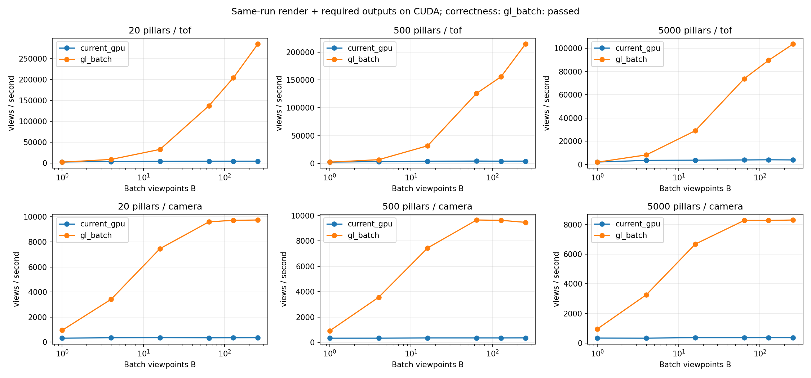
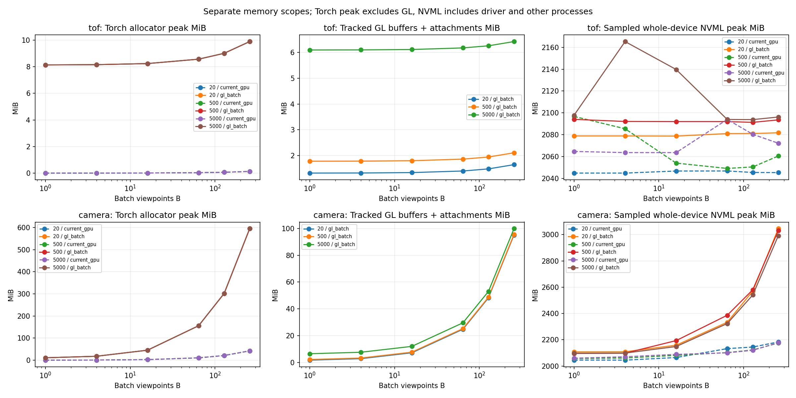

# 共享场景 OpenGL 多视角批处理结果

**保留现有 OpenGL 几何内核、改成真正的多视角提交和 GPU 数据通路后，本轮取得明显吞吐提升，并与原实现输出精确一致。** 在相同 B=256 下，ToF 提升 27.0–66.2 倍，相机及 mask 提升 22.9–27.3 倍。显存增加主要来自批量输出与 GPU 后处理；场景 VBO 始终只有一份。

这轮只新增 `experiments/opengl_batch_eval/`，没有修改正式 sensor、配置、旧实验或项目容器入口。接口和复现命令见 [README.md](README.md)，所有 batch 的数据见 [results.csv](results.csv)，环境、测量与验证摘要见 [results-summary.json](results-summary.json)。

## 具体实现

```text
一份场景 VBO + CUDA Pose[B,4,4]
  → GPU pack / SSBO D2D
  → glDrawArraysInstanced：B 个实例写 B 层 RG32F / D24 纹理
  → 整批纹理 → PBO → CUDA D2D → PyTorch distance / identity[B,H,W]
  → GPU 批量 coverage / range / mask / fraction / bbox
```

ToF 每批 1 次 draw；相机每批 2 次，第二次只画同一 VBO 中的目标区间，计算无遮挡分母。两种模式都没有逐视角 GL draw 或图像 CPU 读回。这里的共享是几何存储共享；每个视角仍需计算自己的变换、遮挡与像素，不能解释成只计算一个视角就得到其他视角。

投影、像素中心平面求交、径向距离排序、guard shell、球体离散与原 sensor 相同；保留无正光学近平面的裁剪和 D24 / LESS 深度测试。变更集中在 Pose SSBO、实例/layer 路由、输出缓冲和 CUDA 互操作。没有新增 C++/CUDA 扩展或安装依赖；底层 API 通过约 170 行 ctypes 接口调用。

GPU 驻留包含显存内搬运：Pose → SSBO、纹理 → PBO、PBO → Torch，以及翻行和 ID 类型转换。它不是零拷贝。资源 map/unmap 也会同步 GL 与 CUDA 队列，依据 [CUDA 官方互操作保证](https://docs.nvidia.com/cuda/cuda-runtime-api/cuda_runtime_api/group__CUDART__INTEROP.html)；layer 路由使用 [Khronos ARB_shader_viewport_layer_array](https://registry.khronos.org/OpenGL/extensions/ARB/ARB_shader_viewport_layer_array.txt)。

## 条件和计时口径

- RTX 5070 Ti，驱动 595.91.07，报告显存 16303 MiB；实验 context 为 OpenGL 4.5，基线为 3.3；Torch 2.7.1+cu128、ModernGL 5.12.0，图像均由 NVIDIA GPU 生成。
- 使用同一现有 Docker 镜像 `sha256:624a4ffc2fc4cdab0fb0ff97b4637f5eb6cbed4b8487ad441b10cca2bf822c47`。复用本机镜像，不声称跨机从零构建已验证；没有修改宿主配置。
- 地图、目标球体、配置和 Pose 序列与上一轮相同：seed=3 的 60×60×15 m 柱场，20 / 500 / 5000 柱，合计分别 16,370 / 22,130 / 76,130 面，包含同一 16,128 面目标球；排除飞机。
- ToF 为 8×8、60°×60°、0.05–12 m；相机为 160×120、80°×60°、0.01–30 m。相机包括深度、mask、可见比例、阈值、框和 target-only 渲染；没有 RGB 材质或物理 ToF 响应。
- 三个场景 × 两种模式 × B=1/4/16/64/128/256 × 两条路径，**72 个独立进程测量单元全部执行成功，无 OOM、无首帧契约失败**。两条路径在同一轮重新测量；基线直接调用原实验的 `current_gpu` worker，没有改其算法或计时。
- `current_gpu` 是现有 sensor 逐视角绘制、读回、CPU 后处理，最后 stack/H2D。`gl_batch` 是准备好的 CUDA Pose 输入，批量渲染并在 GPU 后处理；两条路径的所需输出都到 CUDA。基线 ID 为 int32，新后端为 int64，字节量差异保留在测量中。
- 主指标为同步墙钟中位数，2 次预热、3–5 次测量；包含 GPU pack、SSBO 拷贝、渲染、跨 API 同步、所有必需输出拷贝及后处理。输入 Pose 构造及初次上传在热计时外；静态场景初始化、batch 准备和首次调用另计，纹理/PBO 的惰性分配在首次调用中。CUDA event span 未解释成纯 kernel 时间。

## 相同 B=256 的端到端结果

下表统一使用 B=256，避免通过给两边选择不同 batch 获得倍率。单位为视角/秒，不是四路 ToF 加相机的 rig/秒。

| 柱数 | 模式 | 原顺序 GL → CUDA | 新批量 GL → CUDA | 吞吐比 |
|---:|---|---:|---:|---:|
| 20 | ToF | 4305 | 285086 | 66.2× |
| 500 | ToF | 4071 | 214823 | 52.8× |
| 5000 | ToF | 3843 | 103776 | 27.0× |
| 20 | 相机及 mask | 357 | 9747 | 27.3× |
| 500 | 相机及 mask | 360 | 9461 | 26.3× |
| 5000 | 相机及 mask | 363 | 8306 | 22.9× |



大场景的一批 256 个 ToF 从 **66.61 ms → 2.47 ms**；256 个相机视角从 **705.17 ms → 30.82 ms**。首次调用仍约 120–150 ms，不能用热吞吐估计冷启动请求延迟。B=1 的大场景 ToF 为原路径 0.498 ms、新路径 0.526 ms，未显示单视角收益；相机约为 2.978 ms → 1.046 ms。

相机在 B≈64 已接近本轮吞吐平台，继续增大 B 主要增加显存。大场景 B=256 的独立阶段探针为整场+目标批量渲染及转交 7.38 ms，批量后处理 23.32 ms，端到端 30.82 ms；阶段来自不同运行，不能直接相加。这表明该配置下后处理已占较大成本，但本轮没有做 kernel 级归因或额外优化。

倍率是整个 GPU 通路相对当前完整路径的结果，包含减少逐张调用/读回和改为 GPU 后处理的共同收益，未做消融实验，不能全部归因于 instanced draw。只做了一轮完整 sweep，未进行跨轮统计显著性检验。

## 显存

B=256 下，各统计口径分开列出，单位 MiB。Torch 峰值不含 GL；GL 数字是显式资源，不含驱动填充；NVML 是整个进程运行期间每 5 ms 采样整卡、相对启动前的峰值增量，包含其他进程、驱动、预热与阶段探针，可能漏掉短峰值。

| 柱数 | 模式 | 新后端 Torch 分配峰值 | 新后端 Torch 保留峰值 | 新后端 GL 显式资源 | 新后端 NVML 增量 | 原路径 NVML 增量 |
|---:|---|---:|---:|---:|---:|---:|
| 20 | ToF | 9.9 | 24 | 1.6 | 328 | 292 |
| 500 | ToF | 9.9 | 24 | 2.1 | 328 | 293 |
| 5000 | ToF | 9.9 | 24 | 6.4 | 333 | 298 |
| 20 | 相机 | 595.1 | 764 | 95.1 | 1224 | 410 |
| 500 | 相机 | 595.1 | 764 | 95.5 | 1224 | 410 |
| 5000 | 相机 | 595.1 | 764 | 99.9 | 1228 | 415 |



大场景 VBO 为 **6,394,920 bytes，约 6.10 MiB**，在所有 B 下保持同一份。相机 B=256 的 RG32F 颜色层约 37.5 MiB、D24 按 4 bytes/texel 计约 18.75 MiB、PBO 约 37.5 MiB，再加一份 VBO 和约 17 KiB Pose SSBO；target-only 复用这些 GL 资源，返回的 CUDA 数据独立拥有存储。

GPU 批量后处理及输出使相机 GPU 占用高于当前 CPU 后处理路径；“不复制场景”不等于没有 batch 显存增长。Torch 的约 595 MiB 峰值主要处于输出和后处理数据通路，本轮未进一步做 allocator 分项分析。不同列不能简单相加解释成整卡峰值。

上一轮标准 PyTorch3D 在同一大场景 B=256 相机的 Torch 分配峰值约 5862 MiB、保留 10648 MiB；本轮分别为 595 / 764 MiB，另有约 100 MiB GL 显式资源。这是两轮历史对照，GPU 其他进程状态不同，且 PyTorch3D 未通过语义对齐；不能当作同轮、同等正确性的加速或显存比。

## 正确性与独立复核

1. **30/30 基础及运行契约通过**：29 个现有几何/量程/遮挡/边界/柱场用例，以及 CUDA Pose 原位修改、恢复、不同 stream 的顺序调用、旧输出所有权、单份 VBO 契约。raw 和公开观测的有限深度最大实际误差为 0，类别、ID、mask、框、可见比例和分母均一致。
2. **36/36 全 batch 组合通过，而且所有输出精确相同**：逐像素比较三个场景、两种模式、全部六个 B，共 27,104,448 个公开深度像素，同时核对 raw、相机 target-only raw 和所有相机后处理。即使 B=256，所有层均与原始 Pose 序列逐项对应。
3. 所有 36 个新后端测量单元的首帧实际计数均为 ToF 1 draw / 相机 2 draws；所有 batch 的几何只上传 1 次，VBO 字节数不随 B 变化。运行契约另在同一 renderer 的 B=1/4/16 间验证了 VBO 名称和字节数不变。
4. 独立解析 oracle 仍保留双方共同的 `asymmetric` 边缘反例，涉及原 GL 的 4 个像素；本轮没有新增 oracle 回归，也没有修正式实现。这里的“精确一致”指与原 sensor 对齐，不是证明原成像模型在所有几何边界都正确。

验证比较在计时之外下载最终输出；渲染热路径没有图像 CPU 读回或逐视角提交。独立审查检查了 SSBO 布局、源 shader/D24 语义、map/unmap、stream 与资源生命周期、计时边界、显存口径以及失败进程不会沿用旧 passed 结果；未发现交付阻塞。

## 证据和当前边界

原始 `cells/`、日志、地图、环境指纹、`validation.json` 和 `validation-all-batches.json` 位于 `outputs/opengl_batch_eval/sweep/`。计时期间的源码另存 `measured-source/`；核对所有测量源码 SHA 未变。全 batch 验证脚本在计时后独立执行，再原样纳入本目录，脚本 SHA 和验证时的源码 SHA 也保留在结果摘要中。没有重写已完成的计时值。

本轮仅验证 NVIDIA 同卡 EGL/CUDA、OpenGL 4.5 扩展、固定快照、单宿主线程顺序调用；跨 stream 测试有显式依赖，不代表支持并发操作同一个 context。未验证多卡、动态物体更新、可微渲染、真实 RGB 或物理 ToF。当前卡的层数上限为 2048，实测只到 256；一万个 Pose 仍需要调用方拆批，且输出/后处理显存仍随 batch 增长。

本轮证据支持继续采用“共享场景 + 多视角提交 + GPU 输出和后处理”的方向；正式 sensor API、请求归属、自动组批和场景更新机制尚未改造。
