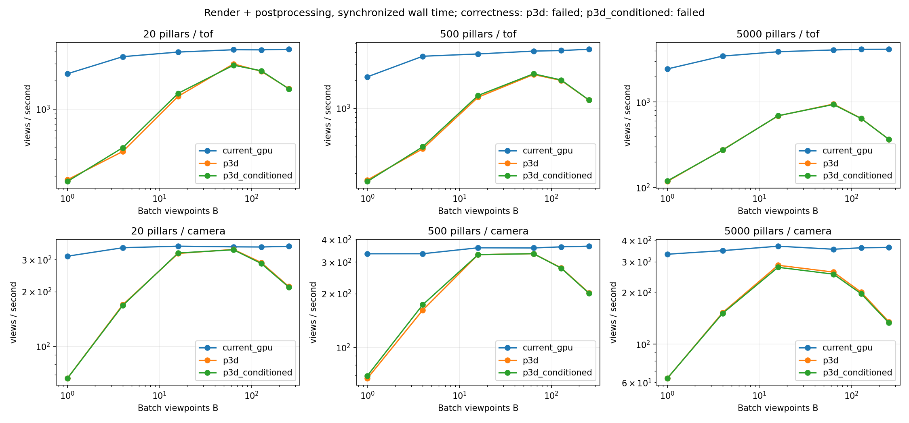
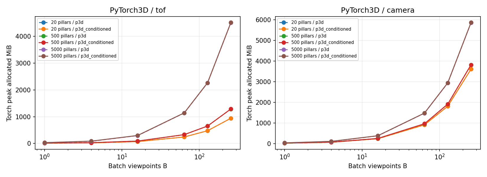

# 批量渲染验证结果

本轮跑通了 Pose batch → PyTorch3D → CUDA 张量 → 批量 ToF / mask / 可见比例 / bbox，全程没有新增 GL、C++ 或 CUDA 扩展代码。**本次配置没有取得吞吐优势，而且渲染语义尚未对齐，不能据此替换正式传感器。** 批量输入和批量后处理的结构仍然可行；这个结果只约束本次 PyTorch3D 实现及参数，不代表批量渲染本身没有价值。

正式 `devtools`、配置、依赖与容器入口均未修改。实验代码和保留的数据仅在本目录，原始产物在 `outputs/pytorch3d_render_eval/sweep/`。用法与依赖前提见 [README.md](README.md)，逐单元数据见 [results.csv](results.csv) 和 [results-summary.json](results-summary.json)。

## 测量条件

- NVIDIA RTX 5070 Ti，驱动 595.91.07，报告总显存 16303 MiB；Torch 2.7.1+cu128，Python 3.10.18，PyTorch3D 0.7.9，固定源码 `88e182f989c80836f4bd744e0d9cb1852762ce01`，编译 sm_120。
- 实验镜像 `sha256:624a4ffc2fc4cdab0fb0ff97b4637f5eb6cbed4b8487ad441b10cca2bf822c47`。复用已有本机 CUDA-devel 基底，未验证跨机从零构建；apt 和传递依赖未全部锁定。
- 基线为本分支 `7d3d2e34c9f01150178c96a3e8a154246bccfbfc` 的 `MeshSensor`。同一份现有 seed=3、60×60×15 m 柱场，20 / 500 / 5000 根柱，分别 16,370 / 22,130 / 76,130 个三角形，均包含同一个 16,128 面目标球体；排除飞机。
- ToF 为 8×8、60°×60°、0.05–12 m；相机为 160×120、80°×60°、0.01–30 m。相机执行整场与 target-only 两次批量光栅化，再处理 mask、可见比例、阈值及框。没有 RGB 材质或真实 ToF 响应模型。
- B=1、4、16、64、128、256；3 场景 × 2 模式 × 3 后端 × 6 个 B，共 **108 个执行单元，全部执行成功，无 coarse bin overflow，无 OOM**。每个单元独立进程，2 次 warmup、3–5 次计时，主指标为同步墙钟中位数。
- 所有输出都到 CUDA：`current_gpu` 原样执行当前传感器，再 stack/H2D；`p3d` 与 `p3d_conditioned` 在 CUDA 中生成并处理结果。输入 Pose 打包、场景初始化、extend、首次执行分开记录，不计入热路径。静态场景与 batch 重复使用；动态更新、梯度、实际请求拼接成本未测。
- P3D：K=1、透视修正、双面渲染，固定 `max_faces_per_bin=32768`。这是显式参数实验，没有做全局参数寻优；计时不能当作该库所有配置的性能上限。

## 吞吐

以下为各条路径在已测 B 中的最好吞吐，括号是对应 B。单位为**视角/秒**，不是四路 ToF 加相机的 rig/秒。不同 B 使用相同确定性 Pose 序列的前缀，完整曲线及每个 B 的结果保留在数据中。

| 柱数 | 模式 | 当前实现 → CUDA | 标准 P3D | 适配 P3D |
|---:|---|---:|---:|---:|
| 20 | ToF | 4238 (256) | 2978 (64) | 2886 (64) |
| 500 | ToF | 4311 (256) | 2305 (64) | 2346 (64) |
| 5000 | ToF | 4157 (256) | 949 (64) | 938 (64) |
| 20 | 相机 | 355 (16) | 341 (64) | 340 (64) |
| 500 | 相机 | 367 (256) | 334 (64) | 334 (64) |
| 5000 | 相机 | 370 (16) | 287 (16) | 279 (16) |

增大 B 能摊薄小 batch 的调用开销，但并非越大越好。大场景相机标准 P3D 从 B=16 的 55.81 ms / 批，变为 B=256 的 1898.08 ms / 批，吞吐由 287 降到 135 视角/秒。小场景相机最佳值比较接近，没有独立重复整轮实验或统计显著性检验，不应从几百分点差异推出稳定优势。

后处理已经批量化：大场景 B=256 时，标准 P3D 的 ToF 端到端 697.77 ms，单独后处理 0.44 ms；相机端到端 1898.08 ms，单独后处理 23.39 ms。阶段来自另外的运行，不能相加；这说明本实现主要成本仍在渲染路径。CUDA event span 含 CPU 提交与库内同步间隙，未当作纯 GPU kernel 时间。

**这些是带正确性失败标记的执行吞吐，不能称为同等语义下的加速比。**

## 显存

下表是标准 P3D 在 B=256 的测量，单位 MiB。`extend` 只计已存在的 vertex/face 数组；完整峰值还含惰性 mesh 缓存、变换、裁剪、coarse bins、fragments、输出与后处理临时张量。

| 柱数 | 模式 | extend 数组 | Torch 分配峰值 | Torch 保留峰值 | NVML 整卡峰值相对启动前增量 |
|---:|---|---:|---:|---:|---:|
| 20 | ToF | 120 | 942 | 1202 | 1931 |
| 500 | ToF | 165 | 1286 | 1722 | 2396 |
| 5000 | ToF | 587 | 4506 | 5438 | 6112 |
| 20 | 相机 | 238 | 3610 | 6514 | 7205 |
| 500 | 相机 | 283 | 3820 | 4370 | 5059 |
| 5000 | 相机 | 705 | 5862 | 10648 | 11353 |

网格确实按 B 复制，但仅看复制量会严重低估总显存。相机分桶缓存在此配置约为 `B × 8 × 10 × 32768 × 4 bytes`，即 10 MiB × B；B=256 时单次光栅调用这一个表就约 2.5 GiB。省略本实验参数、使用保守 2F 容量时，大场景该表会进一步增大，不能把这种 OOM 全归因于 mesh 复制。

Torch 保留量受分配器复用和碎片影响，并不随场景大小严格单调；NVML 每 5 ms 采样整卡，含其他进程与 CUDA/GL 驱动，并可能漏掉短暂峰值。当前 GL 路径的显存不在 Torch allocator 内，不能用它很小的 Torch 数字当作整个 GL 后端的显存。

未实际提交 1 万 Pose；按此大场景 camera 的 `extend` 数组线性计算，1 万份仅数组就约 26.9 GiB，已经超过本卡容量。这个值是下界计算，不是实测峰值。当前 `Meshes.extend` 路径需要分批，不满足“一份 GPU 几何常驻、任意多 Pose”的物理存储要求。

## 正确性

先隔离后处理，再对比完整渲染，避免将深度或 mask 差异混在一起。有限深度容差 20 µm；finite / +inf / NaN、对象 ID、mask、框、计数要求一致，可见比例容差 1e-15。保留全像素差异，另列边缘与内部；没有通过剔除边缘来让总结果通过。

| 检查 | 标准 P3D | 适配 P3D |
|---|---:|---:|
| GL 原始距离/ID → CUDA 后处理 → 对比公开传感器 | 29/29 通过 | 29/29 通过 |
| 包含渲染、解析 oracle、批次一致性的完整用例 | 15/29 通过 | 17/29 通过 |
| 整体验收 | 失败 | 失败 |

批量后处理中的 coverage/range、mask、count、fraction 和 bbox 没有逐张循环或 CPU 读回。GL 原始数据重放使用原始 float64 Pose，P3D 路径使用其实际 float32 Pose；另存量化诊断，不通过改变输入精度来隐藏差异。

标准路径在当前跨光学近平面的场景有明显深度误差。20 柱相机 76,800 像素中有 14,483 个 finite/inf/NaN 类别不同，最大共同有限深度差 29.52 m。固定版本的 [透视重心计算](https://github.com/facebookresearch/pytorch3d/blob/88e182f989c80836f4bd744e0d9cb1852762ce01/pytorch3d/csrc/utils/geometry_utils.cuh#L172-L184) 对分母有绝对阈值，在非常小的近裁剪深度下会影响插值和排序；[硬光栅覆盖规则](https://github.com/facebookresearch/pytorch3d/blob/88e182f989c80836f4bd744e0d9cb1852762ce01/pytorch3d/csrc/rasterize_meshes/rasterize_meshes.cu#L153-L176) 也与 GL 的边缘规则不同。这是本参数和场景组合下的失败，不代表常规相机近平面设置都会出现同样量级误差。

适配路径改为 1 mm 光学近裁剪、重心坐标归一化、微小 blur，并对选中原始面用 float64 求交，改善了大部分深度误差，但没有修好选面与覆盖：

- 500 / 5000 柱 ToF 的 B=8 对比通过；20 柱仍有 1/512 像素类别及对象差异。
- 20 / 500 / 5000 柱相机分别有 85 / 47 / 12 个类别差异。500 柱有边缘选到不同表面的情况，最大有限深度差仍达 5.17 m；不能仅凭 p99 很小宣称等价。
- 无遮挡球体样例应有 664 / 676 个目标像素，适配路径为 638 / 666，框和可见比例虽可相同，mask 与分母已不同。
- 近光学平面遮挡样例仍有 2 像素把应为 NaN 的过近遮挡变成 +inf；1 mm 内光学深度不受支持。微小 blur 的 K=1 候选过滤也可能漏掉后面的有效候选。
- 标准路径在两种柱场 ToF 存在 batch/单张或逆序还原不一致；适配路径在 1×1、目标位于声明域外的退化样例，逆序后有 1 像素原始对象 ID 不同，最终 range 均为 NaN、mask 均为空。

基线也接受独立解析检查：扩展的 asymmetric 箱体样例有 4 个边缘像素，解析 oracle 支持适配 P3D、与当前 GL 不同。因此不能把所有差异都归为 PyTorch3D 错误；正式模块未在本轮改动。原有六组传感器检查在实验镜像中仍通过，新样例暴露的是原检查之外的边界。

## 证据与适用范围

原始 108 个单元、两份完整验证、日志、地图 SHA、源码 SHA、pip freeze 与 GPU 前后状态位于 `outputs/pytorch3d_render_eval/sweep/`。`validation.json` 对应适配路径，`validation-stock.json` 对应标准路径；汇总按后端绑定，执行 `ok` 与验证 `failed` 分别保留。原始首次失败和数值探针保留在上一级输出目录，没有用后续适配覆盖。

计时结束后只修正了汇总器的后端验证标签、显存图分线，并增加同时验证两条路径的入口；`worker.py`、后端、Pose、后处理、验证器均未改变。原测量源码另存 `measured-source/`，测量与分析 SHA 分别在 `environment.json` / `analysis-environment.json`；最终双后端入口另做 Docker smoke 验证。独立审查检查了计时边界、显存口径、overflow 与报告关联，上述限制均保留。

本轮支持的判断是：**可以少写原生代码，把当前理想 ToF 和 mask 后处理直接组织成 GPU batch；但当前标准/小范围适配的 PyTorch3D 路径既未完成正确性对齐，也没有显示出替换现有实现的性能收益。** 后端选择与正式重构应继续保持待定，不从本次失败直接推导“必须自写 GL/Vulkan”。
